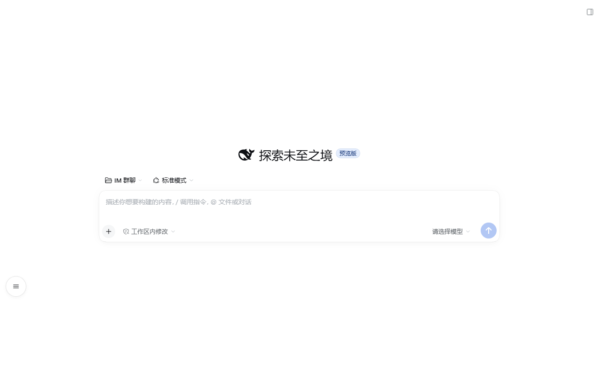

# dsh-sidebar-tidy

DSH Web 左侧栏精简 + 移动抽屉布局插件（`0.2.2-rc.3`，与当前 DSH 版本保持一致）。



- 内嵌列表：不是浮层，会自然把下面的工作区/会话列表挤下去；侧栏收起成 rail 时退回浮层。
- 顶部固定：侧栏滚动时，「插件 / Superagent / … / 更多」这一段 sticky 在顶部；品牌行、新会话本来就在滚动区外，底部用户/设置区也保持固定。保留滚动区原有 8px 顶距并用负向填充盖住，滚动开始/结束不会跳一下。
- 拖拽：侧栏按钮上下拖＝排序，拖到「更多」下方＝收起；「更多」里的行上下拖＝排序，拖回侧栏＝重新固定。
- 图标：直接渲染面板注册在 `sidebar.panellist` 里的图标组件，第三方插件面板也能显示真实图标。
- 主题：全部使用 `--dsw-alias-*` 主题 token，明暗模式共用一套样式（拖拽提示使用 tooltip 语义色，避免深色模式下白底白字）。
- 移动布局：融合 WSL web 侧 `dsh-mobile-layout` 的抽屉/FAB/遮罩，并按当前 DSH 0.2.2-rc.3 的锚点重写；默认 `always`（任意宽度，复刻 WSL 插件），可在 **设置 → 通用 → 移动布局** 切到 `auto`（仅窄屏）或 `off`。

## 移动抽屉布局（融合 WSL 侧插件）

「设置 → 通用」里新增一行 **移动布局**，用下拉选择三档，选择立即生效并写入 localStorage：

| 模式 | 行为 |
|---|---|
| `always`（默认） | 任意宽度都启用：聊天区占满、左下角 ☰ FAB、侧栏以 280px 抽屉从左侧滑入 + 遮罩（WSL 原插件行为） |
| `auto` | 视口 `<= 1023px` 时启用；桌面宽度完全保持官方布局 |
| `off` | 不启用移动布局 |

动画：抽屉打开 240ms 滑入；收起时先给 `st-ml-closing` 类做 180ms 滑出 + 遮罩淡出，动画结束后才真正移除抽屉，避免瞬间消失；`prefers-reduced-motion: reduce` 时自动关闭动画。

左上角官方「打开侧边栏」按钮与圆形 FAB 共用一套开合逻辑：移动模式下点它打开抽屉；抽屉打开后点侧栏内的折叠按钮，会走同样的 180ms 滑出动画。抽屉收起时会同步收回官方侧栏，左上角按钮保持可见，不会出现「按钮消失 / 点了又奇怪地收回」。

官方 `shell.leading` 座位在 Windows 位于标题栏（frame 的 `padding-top` 区域），收起侧栏时直接用它会让按钮“跳到标题栏”。移动模式统一隐藏官方 opener，并把打开按钮注册进 `conversation.header.leading`（对话顶栏 leading 座位），和标题 / 应用 / 编辑等顶栏内容处于同一行；只有页面没有对话顶栏时才退回 fixed 兜底按钮。

实现使用 0.2.2-rc.3 的稳定锚点：`[data-shell-overlay]`、`[data-sidebar-toggle]` / `[data-sidebar-opener]`、`data-sidebar-collapsed`、`data-sidebar-right-panel` / `data-sidebar-right-open`、`[data-composer-card]`；不依赖哈希类名、不写死 0.1.2 的中文文案。

## 日志

日志由 Host 半侧写入：

```
D:\DSH-plugins\log\dsh-sidebar-tidy\dsh-sidebar-tidy-YYYY-MM-DD.log
```

每天一个文件；单文件超过 4 MiB 时滚到 `*.log.1`（只保留一份备份）。每行格式：

```
2026-11-14T14:40:00.123+08:00 | INFO  | host   | plugin.apply             | dsh-sidebar-tidy host half activated | {"version":"0.2.2-rc.3",...}
2026-11-14T14:40:05.000+08:00 | INFO  | client | more.open                | 打开「更多」 | {"hidden":2,"rail":false} page={"id":"ab12cd34","path":"/","locale":"zh","dark":true}
```

客户端通过 DSH 官方的 **Connection 共享 `/api` 通道**上报：

- Host：`ctx.connection.fetch.register({ path: '/api/dsh-sidebar-tidy/log', methods: ['POST'], fetch })`
- Client：`ctx.connection.rpc.call('/api', 'dsh-sidebar-tidy/log', { records, page })`

由 DSH 的 Connection 层完成 Host/Origin 校验、浏览器 Cookie 鉴权与 `server-response` 信封校验；插件不需要自建 HTTP 路由或注入 token。

> 为什么不用 `connection.rpc.handle(channel, handler)`？当前 DSH 版本的实现会用 Connection 服务自身的 Context 去访问 `webServer`，而该 Context 没有 `inject('webServer')`，注册时会直接抛 `cannot get property "webServer" without inject`。共享 `/api` 通道的 exact Fetch 路由是同一层的官方替代路径（`dsh-client-file-upload`、`dsh-plugin-manager` 也使用 `connection.fetch.register`）。

日志失败只会在控制台提示，不影响侧栏功能。

可选配置（`cordis.patch.yml` 的 `config`）：

```yaml
- insert:
    - id: sidebar-tidy
      name: dsh-sidebar-tidy
      config:
        logDir: 'D:/DSH-plugins/log/dsh-sidebar-tidy'
        enabled: true
        level: debug          # debug | info | warn | error
        maxFileBytes: 4194304 # 4 MiB
        maxRecords: 200       # 单次 RPC 最多接收条数
```

## 使用的 DSH 接口审计

| 接口 | 用途 | 结论 / 说明 |
|---|---|---|
| `ctx.slots.register` / `ctx.slots.inject` | 注册兜底「更多」菜单、监听槽位声明 | 官方接口，保留 |
| `ctx.slots.entriesOfSlot` / `entry.component` | 读取面板注册的图标组件 | SlotCore 暴露的方法与 `StoredEntry` 类型可见；目前没有面向业务的“读取他人图标”公开 API。`sidebar.panel.icon` factory 只能在侧栏自己的 React 树里渲染，无法在命令式 DOM 菜单中直接使用。保留，并对渲染失败做兜底与日志 |
| `ctx.slots.subscribe` | 面板/侧栏变化后重算 | 官方接口，保留 |
| `ctx.locale.register` / `getSnapshot` / `bind` | 中文文案、面板 label、图标组件 `t` | 官方接口，保留 |
| `ctx.layout.selectPanel` | 点击「更多」行切换面板 | 官方接口，保留 |
| `ctx.pluginNavigation.openList` | 「浏览更多插件」入口 | **不是核心服务**：由 `ui-plugin-manager` 动态 `ctx.reflect.provide('pluginNavigation', ...)`。原实现把它列进硬 `inject`，缺少插件管理器时整个插件不会激活。已改为运行时 `ctx.get('pluginNavigation')`，缺失时隐藏该入口 |
| `ctx.uiWorkspace.startSession` | 「创建你的插件」入口 | 官方服务；同样改为可选读取，缺失时隐藏入口 |
| `sidebar.inject().setPinned` | 收起/固定面板 | 侧栏注册者私有的 inject 面，没有公开替代 API。保留并加降级日志（找不到时提示面板可能未真正收起） |
| `entry.options.order` + `ctx.locale.register` 抖动 | 持久化面板顺序并触发侧栏重算 | 没有公开的排序/刷新 API；属于兼容性取巧，升级 DSH 后需回归验证 |
| `require('react-dom')` / `react-dom/client` | 把 `entry.component` 序列化成 SVG 标记 | `react-dom` 是平台基线共享模块（renderer 自身依赖）；没有官方的“组件转 HTML”接口。失败会退回内置图标并记录 `icon.fallback` |
| Host `ctx.connection.fetch.register` + 共享 `/api` 通道 | 接收客户端日志 | 官方客户端↔Host 通道，自带鉴权与信封校验；`connection.rpc.handle` 在当前版本因 `webServer` inject 问题不可用，已在代码注释中记录原因 |
| Host `ctx.logger` | 控制台镜像/降级提示 | 可选接口，缺失时静默 |

## 从 WSL 版 `dsh-mobile-layout` 修复的 bug

融合时没有直接搬旧代码，而是按 0.2.2-rc.3 重写，修掉了下面这些问题：

| 旧实现 | 问题 | 本插件处理 |
|---|---|---|
| `setInterval(sync, 250)` + 300ms 找 frame | 永久轮询耗 CPU，frame 找不到时一直跑 | MutationObserver + rAF 合帧；找不到 frame 有上限重试与一次告警 |
| `installStyles` 无清理 | 插件卸载后 `<style>` 残留 | 返回 disposer，卸载时移除 |
| 写死 0.1.2 中英文 toggle 文案 | 0.2.2 改语言/改文案后找不到按钮 | 用 `data-sidebar-toggle` / `data-sidebar-opener` 属性 |
| `findFrame` 只认 `[data-shell-overlay]` 父节点 | 结构变化时永远不挂载 | 保留该锚点并加空值兜底 |
| `data-sidebar-collapsed` + 合成 click | 慢启动/React 未就绪时丢点击 | 优先 `ctx.layout.toggleSidebar()`，失败才回退按钮 |
| `markComposerRow` | 卸载后 `dshml-composer-row` 类残留 | 列为清理项，卸载时统一摘除 |
| `body` safe-area padding 全局写入 | 关掉插件后仍改变页面 padding | 只在 `html.st-ml-on` 下生效，卸载即恢复 |
| 任何宽度强制移动布局 | 桌面侧栏被 FAB 取代 | 改为 `auto`（窄屏）/`always`/`off` 三档 |
| 旧 `z-index` 硬编码 14/25/26 | 弹层/遮罩可能盖住抽屉内 popover | 保留抽屉 26 > 遮罩 25 的关系，FAB 30 |
| 无 Esc/无本地化 aria-label | 键盘不可关、读屏文案固定中文 | 支持 Esc；FAB aria-label 跟随 DSH 语言 |

## 已知限制

- `pluginNavigation`、`uiWorkspace` 缺失时对应入口会隐藏；侧栏精简与其他功能不受影响。
- 面板顺序依赖修改 `entry.options.order` 并抖动 locale revision，属于对当前 DSH 版本行为的兼容实现。
- 日志目录、单文件上限、级别均可在 plugin config 中改；不会自动删除历史日志。
- 移动抽屉布局是 DOM/CSS overlay：DSH 改版导致 frame/侧栏结构变化时可能失效；找不到 frame 时只告警一次，不隐藏任何内容。
- 抽屉没有实现焦点陷阱（与原 WSL 插件一致），键盘用户可用 Esc 关闭。
- WSL 原插件里针对 `[data-dsh-stats]` / Aqua 主题的装饰性分隔线没有搬入（它属于 WSL profile 的第三方主题，不是 DSH 核心结构）。

移动布局功能融合自 MIT 许可的 WSL 侧插件 `dsh-mobile-layout`，本仓库按 DSH 0.2.2-rc.3 的锚点与接口重写。
