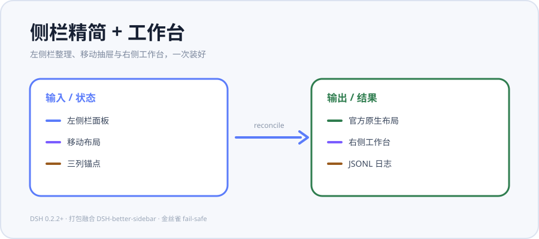

**dsh-sidebar-tidy** bundles a tidier left sidebar, a mobile drawer, and the right-side workbench into one DSH plugin.

- **Tidy left sidebar**: keep a whitelist of panels, fold the rest into an inline More list, and reuse each panel's real icon (third-party panels included).
- **Drag to reorganize**: reorder by dragging, drop into More to fold, drag back to pin again; order persists.
- **Pinned top section**: panel rows stay sticky while the session list scrolls; the brand, new-session and footer areas stay fixed.
- **Mobile drawer**: on narrow screens the sidebar becomes a left drawer with FAB, scrim and slide animation; switch `Always / Narrow only / Off` under **Settings → General → Mobile layout**.
- **Canary fail-safe**: after being armed by a healthy three-column layout, 40 consecutive missing-anchor ticks (250ms) remove the mobile CSS, FAB, scrim and column marks, restoring the stock layout with one warning.
- **Bundled DSH-better-sidebar**: the right-hand file tree, editor, Git, tasks, side chat and bottom terminal workbench are installed together and keep upgrading independently.
- **Theme and logs**: follows DSH theme tokens; host logs are daily `host-YYYY-MM-DD.jsonl` files, one JSON per line, rotating above 2 MiB with five backups.

> For users who want a quieter left sidebar without giving up the right-hand workbench.

**Panel-area hiding**: under Settings → General choose row-level hiding or a background patch cloned from the sidebar wallpaper; the list keeps scrolling normally.
