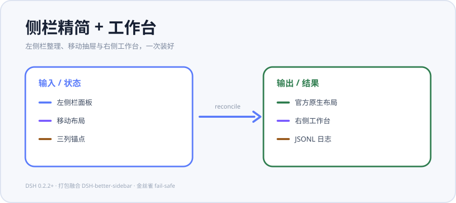

**dsh-sidebar-tidy** 把左侧栏整理、移动抽屉和右侧工作台收进一个 DSH 插件：一次安装，同时得到「更清爽的左侧栏」和「能干活的工作台」。

- **左侧栏精简**：白名单面板留在侧栏，其余收进「更多」内嵌列表；直接复用面板注册的真实图标，第三方插件也不再变成小圆点。
- **拖拽重组**：上下拖动排序，拖进「更多」收起，拖回来重新固定；顺序持久化。
- **顶部固定**：滚动会话列表时，面板区 sticky 在顶部；品牌行、新会话和底部用户区本来就不随列表滚动。
- **移动抽屉**：窄屏自动把侧栏收成左侧抽屉，带 FAB、遮罩、滑出动画；在 **设置 → 通用 → 移动布局** 切换 `始终 / 仅窄屏 / 关闭`。
- **金丝雀 fail-safe**：健康武装后连续 40 次（250ms/tick）三列 DOM 锚点全丢，自动撤掉移动布局 CSS、FAB、遮罩和列标记，交还官方原生布局，并只告警一次。
- **打包融合 DSH-better-sidebar**：右侧文件树、编辑器、Git、任务、侧聊和底部终端工作台一并安装，并保留上游独立升级。
- **主题与日志**：全部跟随 DSH 主题 token；Host 日志按天写入 `host-YYYY-MM-DD.jsonl`，每行一个 JSON，单文件超 2 MiB 自动改名并保留 5 份。

> 适合：希望左侧栏更安静、又不想在右侧工作台和插件之间来回切换的 DSH 用户。
